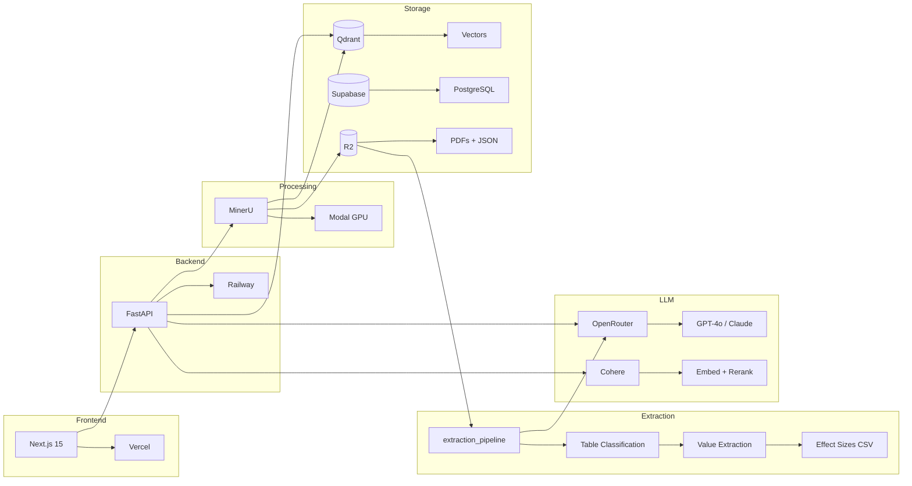

<p align="center">
  
  
  
  
</p>

<h1 align="center">🔬 DevChat</h1>

<p align="center">
  <strong>AI-Powered Research Workbench for Academic Literature</strong><br>
  Multi-tenant RAG platform with citation-grounded synthesis
</p>

<p align="center">
  <a href="https://dev-chat-frontend.vercel.app/">🚀 Live Demo</a> •
  <a href="#-features">Features</a> •
  <a href="#%EF%B8%8F-architecture">Architecture</a> •
  <a href="#-quick-start">Quick Start</a> •
  <a href="#-learn-the-codebase">Learn the Codebase</a>
</p>

---

## ✨ What is DevChat?

DevChat is an **enterprise-grade RAG platform** designed for researchers and evidence synthesis teams. Upload your PDFs, and chat with your literature using state-of-the-art retrieval and citation-grounded responses.

<table>
<tr>
<td width="50%">

### 🎯 For Researchers

- Upload PDFs and create personal research collections
- Ask complex questions across your documents
- Get answers with **clickable citations** that jump to PDF pages
- Export citations in BibTeX, RIS, or CSV

</td>
<td width="50%">

### 🏢 For Organizations

- **Multi-tenant** - Each user has isolated document collections
- **Admin dashboard** - Monitor usage, costs, and quality
- **Langfuse observability** - Full LLM tracing and debugging
- **Scalable** - GPU processing on Modal, vectors on Qdrant Cloud

</td>
</tr>
</table>

---

## 📚 Learn the Codebase

DevChat includes a **comprehensive 50-part tutorial series** to help you understand and extend the codebase:

- **Part 1: Foundations (Posts 1-10)** ✅ Complete
  - Project architecture, Python/FastAPI/Next.js fundamentals, database setup, authentication, testing, deployment
- **Part 2: Document Processing (Posts 11-20)** 🚧 Coming soon
  - PDF parsing with MinerU, chunking strategies, metadata enrichment, Modal GPU pipeline
- **Part 3: RAG System (Posts 21-30)** 🚧 Coming soon
  - Vector embeddings, Qdrant, hybrid search, reranking, contextual retrieval
- **Part 4: Synthesis & Citations (Posts 31-40)** 🚧 Coming soon  
  - LLM integration, Claim Ledger, MiniCheck verification, citation grounding
- **Part 5: Production (Posts 41-50)** 🚧 Coming soon
  - Multi-tenancy, admin dashboard, observability, scaling, cost optimization

**📖 [Start Learning →](tutorials/README.md)**  
**⏱️ ~42 hours total** • Real-world analogies • Hands-on exercises • DevChat code examples

---

## �📊 Quality Metrics

Our systems have been rigorously evaluated:

### Citation Quality (RAG)
| Metric | Score | Description |
| :----: | :---: | ----------- |
| 🎯 **Faithfulness** | **66.5%** | Claims grounded in retrieved documents |
| 📚 **Citation Recall** | **98.9%** | All claims properly cited |
| ✅ **Citation Precision** | **98.9%** | Citations point to correct sources |

### Extraction Pipeline V3
| Metric | Value | Description |
| :----: | :---: | ----------- |
| 📋 **Table Classification** | **88%+** | Accuracy on ground truth annotations |
| 📊 **RESULTS Tables** | **1,115** | From 86 studies in corpus |
| 🔢 **Values Extracted** | **11,765** | Coefficients, SEs, p-values |
| 📈 **Coefficient Coverage** | **100%** | All rows have coefficient value |
| 📉 **SE Coverage** | **57.7%** | Standard errors found |
| 📌 **P-value Coverage** | **30.2%** | P-values extracted |

---

## 🚀 Features

<table>
<tr>
<td width="33%">

### 📄 Smart Ingestion

- **MinerU GPU parsing** - Tables, figures, equations
- **8-step post-processing** - Artifact removal, header grafting
- **List of Tables repair** - Fix corrupted captions from TOC
- **Page-aware chunking** - 256 words with page tracking
- **Metadata enrichment** - CrossRef/OpenAlex lookup

</td>
<td width="33%">

### 🔍 Hybrid Search

- **Dense vectors** - Cohere embed-v4 (1536d)
- **Binary quantization** - ~32x faster search, 95% recall
- **Sparse vectors** - BM25-style keyword matching
- **HyDE expansion** - Hypothetical document queries
- **Cohere reranking** - Precision filtering

</td>
<td width="33%">

### 💬 Grounded Synthesis

- **Claim Ledger** - Extract claims, match to sources
- **Inline citations** - `[Author, Year, p.X]`
- **PDF viewer** - Click citations → jump to page
- **Post-hoc verification** - NLI faithfulness check

</td>
</tr>
</table>

### 📊 Extraction Pipeline V3

Automatically extract effect sizes from academic papers:

```bash
# Classify all tables in corpus
python -m extraction_pipeline.batch.classify

# Extract values from RESULTS tables
python -m extraction_pipeline.batch.extract

# Full pipeline for single study
python -m extraction_pipeline.pipeline --study_id 121058356
```

| Stage | Tool | Output |
| ----- | ---- | ------ |
| **1. Post-process** | `mineru_postprocessor.py` | Remove artifacts (52→45 tables) |
| **2. Caption repair** | `list_of_tables_parser.py` | Fix 9 corrupted captions |
| **3. Classify** | `table_classifier_v3.py` | RESULTS / DESCRIPTIVE / SKIP |
| **4. Extract** | `batch_extract_values.py` | Coefficients, SEs, p-values |

### 🎛️ Admin Panel

| Tab | Capabilities |
| --- | ------------ |
| **Overview** | Usage stats, cost projections, system health |
| **Users & RAGs** | All users, projects, document counts |
| **Quality** | Langfuse experiments, baseline metrics |
| **Documents** | Processing status, metadata review |

---

## 🏗️ Architecture



---

## 🔧 Tech Stack

<table>
<tr><td><b>Frontend</b></td><td>Next.js 15, TypeScript, Tailwind CSS, shadcn/ui</td></tr>
<tr><td><b>Backend</b></td><td>FastAPI, Python 3.12, Pydantic v2</td></tr>
<tr><td><b>Auth</b></td><td>Supabase Auth (JWT + RLS)</td></tr>
<tr><td><b>Database</b></td><td>Supabase PostgreSQL</td></tr>
<tr><td><b>Vectors</b></td><td>Qdrant Cloud (dense + sparse)</td></tr>
<tr><td><b>Embeddings</b></td><td>Cohere embed-v4 (1536 dims)</td></tr>
<tr><td><b>Reranking</b></td><td>Cohere rerank-v3.5</td></tr>
<tr><td><b>LLM</b></td><td>OpenRouter → GPT-4o, Claude, Gemini</td></tr>
<tr><td><b>PDF Processing</b></td><td>MinerU 2.6.8 on Modal (T4 GPU)</td></tr>
<tr><td><b>Storage</b></td><td>Cloudflare R2</td></tr>
<tr><td><b>Observability</b></td><td>Langfuse</td></tr>
</table>

---

## 🚀 Quick Start

### Prerequisites

```bash
# Required accounts
- Supabase (auth + database)
- Qdrant Cloud (vectors)
- Modal (GPU processing)
- OpenRouter (LLM)
- Cohere (embeddings + reranking)
- Cloudflare R2 (storage)
```

### Backend

```bash
# Clone repository
git clone https://github.com/lsempe77/dev_chat.git
cd dev_chat

# Create virtual environment
python -m venv .venv
source .venv/bin/activate  # or .venv\Scripts\activate on Windows

# Install dependencies
pip install -e .

# Configure environment
cp .env.example .env
# Edit .env with your API keys

# Run locally
uvicorn api.server:app --reload --port 8000
```

### Frontend

```bash
cd frontend
npm install
npm run dev
```

### Modal Worker

```bash
# Deploy GPU processing worker
modal deploy infrastructure/modal_mineru.py
```

---

## 📁 Project Structure

```
devchat_v2_sota/
├── 📂 api/                    # FastAPI backend
│   ├── routes/               # API endpoints
│   │   ├── admin/           # Admin panel APIs
│   │   ├── chat.py          # Chat/query endpoint
│   │   └── rags.py          # RAG management
│   └── schemas/              # Pydantic models
│
├── 📂 src/                    # Core Python libraries
│   ├── agents/               # DevChatAgent (orchestrator)
│   ├── retrieval/            # HybridRetriever
│   ├── generation/           # ClaimLedger synthesis
│   ├── ingestion/            # Embeddings, parsers
│   └── utils/                # Langfuse, caching
│
├── 📂 extraction_pipeline/    # Table extraction & classification
│   ├── core/                 # Config, errors, LLM client
│   ├── adapters/             # Schema conversion
│   ├── postprocessing/       # Effect sizes, outcome classification
│   ├── table_classifier_v3.py  # LLM-based classification
│   ├── batch_classify_v3.py    # Batch classification
│   ├── batch_extract_values.py # Extract coefficients/SEs
│   ├── mineru_postprocessor.py # 8-step artifact removal
│   └── list_of_tables_parser.py # Caption repair
│
├── 📂 frontend/               # Next.js 15 app
│   └── src/
│       ├── app/              # App router pages
│       ├── components/       # React components
│       └── lib/              # API clients
│
├── 📂 infrastructure/         # Modal configs
├── 📂 evaluation/             # Quality metrics
├── 📂 scripts/                # Utilities
├── 📂 tutorials/              # 50-part learning series
├── 📂 docs/                   # Documentation
└── 📂 archive/                # Historical files
```

---

## 📚 Documentation

| Document | Description |
| -------- | ----------- |
| [SETUP_TRACKER.md](SETUP_TRACKER.md) | Current implementation status |
| [docs/ROADMAP.md](docs/ROADMAP.md) | Future features and priorities |
| [docs/EVALUATION.md](docs/EVALUATION.md) | Citation quality evaluation |
| [CHANGELOG.md](CHANGELOG.md) | Version history |

---

## 🗺️ Roadmap

### ✅ Completed

- [x] Multi-tenant RAG with per-user collections
- [x] Hybrid search (dense + sparse vectors)
- [x] Citation-grounded synthesis with Claim Ledger
- [x] Admin panel with usage & cost tracking
- [x] Langfuse observability integration
- [x] Zotero bibliography sync
- [x] Per-RAG model selection (GPT-4o / Claude / Gemini)
- [x] PDF citation highlighting with inline viewer
- [x] Study design classification (22 types)
- [x] Contextual retrieval (49% fewer failures)
- [x] Parent-child chunking
- [x] **Extraction Pipeline V3** - LLM table classification with 88%+ accuracy
- [x] **MinerU Post-Processing** - 8-step artifact removal (52→45 tables)
- [x] **List of Tables Cross-Reference** - Caption repair from TOC
- [x] **Batch Value Extraction** - 11,765 effect sizes from 1,115 RESULTS tables

### 🔜 Coming Soon

See [docs/ROADMAP.md](docs/ROADMAP.md) for the full prioritized list.

**Immediate:**

- Study design filter in Evidence Panel
- Auto-classify on document ingest

**Short-Term:**

- Improve faithfulness (66% → 70%+)
- Smart citations (supporting/contrasting)
- Consensus meter visualization

---

## 🙏 Acknowledgments

Built with ❤️ by **[3ie](https://www.3ieimpact.org/)** (International Initiative for Impact Evaluation)

<p align="center">
  <sub>Empowering evidence-informed decision making through AI</sub>
</p>

---

<p align="center">
  <a href="https://dev-chat-frontend.vercel.app/">
    
  </a>
</p>
