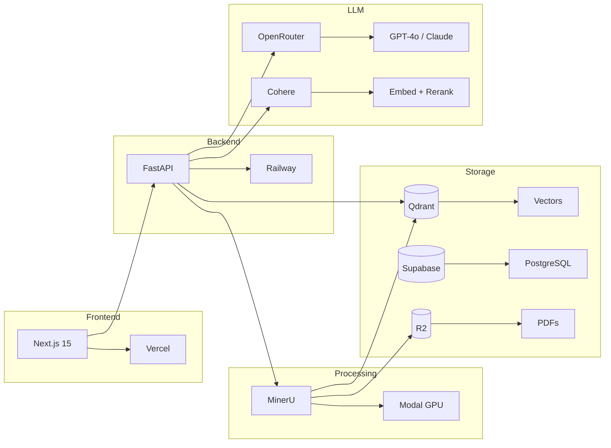

<p align="center">
  
  
  
  
</p>

<h1 align="center">🔬 DevChat</h1>

<p align="center">
  <strong>AI-Powered Research Workbench for Academic Literature</strong><br>
  Multi-tenant RAG platform with citation-grounded synthesis
</p>

<p align="center">
  <a href="https://dev-chat-frontend.vercel.app/">🚀 Live Demo</a> •
  <a href="#-features">Features</a> •
  <a href="#%EF%B8%8F-architecture">Architecture</a> •
  <a href="#-quick-start">Quick Start</a>
</p>

---

## ✨ What is DevChat?

DevChat is an **enterprise-grade RAG platform** designed for researchers and evidence synthesis teams. Upload your PDFs, and chat with your literature using state-of-the-art retrieval and citation-grounded responses.

<table>
<tr>
<td width="50%">

### 🎯 For Researchers
- Upload PDFs and create personal research collections
- Ask complex questions across your documents
- Get answers with **clickable citations** that jump to PDF pages
- Export citations in BibTeX, RIS, or CSV

</td>
<td width="50%">

### 🏢 For Organizations
- **Multi-tenant** - Each user has isolated document collections
- **Admin dashboard** - Monitor usage, costs, and quality
- **Langfuse observability** - Full LLM tracing and debugging
- **Scalable** - GPU processing on Modal, vectors on Qdrant Cloud

</td>
</tr>
</table>

---

## 📊 Quality Metrics

Our citation quality has been rigorously evaluated:

| Metric | Score | Description |
|:------:|:-----:|-------------|
| 🎯 **Faithfulness** | **66.5%** | Claims grounded in retrieved documents |
| 📚 **Citation Recall** | **98.9%** | All claims properly cited |
| ✅ **Citation Precision** | **98.9%** | Citations point to correct sources |

*Evaluated on 8 golden queries using MiniCheck NLI verification*

---

## 🚀 Features

<table>
<tr>
<td width="33%">

### 📄 Smart Ingestion
- **MinerU GPU parsing** - Tables, figures, equations
- **Page-aware chunking** - 256 words with page tracking
- **Metadata enrichment** - CrossRef/OpenAlex lookup
- **Zotero sync** - Import entire collections

</td>
<td width="33%">

### 🔍 Hybrid Search
- **Dense vectors** - Cohere embed-v4 (1536d)
- **Sparse vectors** - BM25-style keyword matching
- **HyDE expansion** - Hypothetical document queries
- **Cohere reranking** - Precision filtering

</td>
<td width="33%">

### 💬 Grounded Synthesis
- **Claim Ledger** - Extract claims, match to sources
- **Inline citations** - `[Author, Year, p.X]`
- **PDF viewer** - Click citations → jump to page
- **Post-hoc verification** - NLI faithfulness check

</td>
</tr>
</table>

### 🎛️ Admin Panel

| Tab | Capabilities |
|-----|--------------|
| **Overview** | Usage stats, cost projections, system health |
| **Users & RAGs** | All users, projects, document counts |
| **Quality** | Langfuse experiments, baseline metrics |
| **Documents** | Processing status, metadata review |

---

## 🏗️ Architecture



### Full Architecture Diagram
See [`devchat_architecture_enhanced_v2.mermaid`](devchat_architecture_enhanced_v2.mermaid) for the complete system diagram.

---

## 🔧 Tech Stack

<table>
<tr><td><b>Frontend</b></td><td>Next.js 15, TypeScript, Tailwind CSS, shadcn/ui</td></tr>
<tr><td><b>Backend</b></td><td>FastAPI, Python 3.12, Pydantic v2</td></tr>
<tr><td><b>Auth</b></td><td>Supabase Auth (JWT + RLS)</td></tr>
<tr><td><b>Database</b></td><td>Supabase PostgreSQL</td></tr>
<tr><td><b>Vectors</b></td><td>Qdrant Cloud (dense + sparse)</td></tr>
<tr><td><b>Embeddings</b></td><td>Cohere embed-v4 (1536 dims)</td></tr>
<tr><td><b>Reranking</b></td><td>Cohere rerank-v3.5</td></tr>
<tr><td><b>LLM</b></td><td>OpenRouter → GPT-4o, Claude, Gemini</td></tr>
<tr><td><b>PDF Processing</b></td><td>MinerU 2.6.8 on Modal (T4 GPU)</td></tr>
<tr><td><b>Storage</b></td><td>Cloudflare R2</td></tr>
<tr><td><b>Observability</b></td><td>Langfuse</td></tr>
</table>

---

## 🚀 Quick Start

### Prerequisites

```bash
# Required accounts
- Supabase (auth + database)
- Qdrant Cloud (vectors)
- Modal (GPU processing)
- OpenRouter (LLM)
- Cohere (embeddings + reranking)
- Cloudflare R2 (storage)
```

### Backend

```bash
# Clone repository
git clone https://github.com/lsempe77/dev_chat.git
cd dev_chat

# Create virtual environment
python -m venv .venv
source .venv/bin/activate  # or .venv\Scripts\activate on Windows

# Install dependencies
pip install -e .

# Configure environment
cp .env.example .env
# Edit .env with your API keys

# Run locally
uvicorn api.server:app --reload --port 8000
```

### Frontend

```bash
cd frontend
npm install
npm run dev
```

### Modal Worker

```bash
# Deploy GPU processing worker
modal deploy infrastructure/modal_mineru.py
```

---

## 📁 Project Structure

```
devchat_v2_sota/
├── 📂 api/                    # FastAPI backend
│   ├── routes/               # API endpoints
│   │   ├── admin/           # Admin panel APIs
│   │   ├── chat.py          # Chat/query endpoint
│   │   └── api.py           # RAG management
│   └── schemas/              # Pydantic models
│
├── 📂 src/                    # Core Python libraries
│   ├── agents/               # DevChatAgent (orchestrator)
│   ├── retrieval/            # HybridRetriever
│   ├── generation/           # ClaimLedger synthesis
│   ├── ingestion/            # Embeddings, parsers
│   └── utils/                # Langfuse, caching
│
├── 📂 frontend/               # Next.js 15 app
│   └── src/
│       ├── app/              # App router pages
│       ├── components/       # React components
│       └── lib/              # API clients
│
├── 📂 infrastructure/         # Modal configs
├── 📂 evaluation/             # Quality metrics
├── 📂 scripts/                # Utilities
├── 📂 docs/                   # Documentation
└── 📂 archive/                # Historical files
```

---

## 📚 Documentation

| Document | Description |
|----------|-------------|
| [SETUP_TRACKER.md](SETUP_TRACKER.md) | Detailed progress and implementation notes |
| [EVALUATION_FRAMEWORK.md](docs/EVALUATION_FRAMEWORK.md) | Citation quality evaluation approach |
| [CHANGELOG.md](CHANGELOG.md) | Version history |

---

## 🗺️ Roadmap

### ✅ Completed
- [x] Multi-tenant RAG with per-user collections
- [x] Hybrid search (dense + sparse vectors)
- [x] Citation-grounded synthesis with Claim Ledger
- [x] Admin panel with usage & cost tracking
- [x] Langfuse observability integration
- [x] Zotero bibliography sync
- [x] Quality monitoring with baseline metrics

### 🔜 Coming Soon
- [ ] **Per-RAG model selection** - Choose GPT-4o vs Claude vs Gemini per project
- [ ] **User feedback** - 👍/👎 on responses for quality improvement
- [ ] **A/B experiments** - Compare prompts and models in Langfuse
- [ ] **Advanced search filters** - Year, country, methodology in chat

### 🔮 Future Exploration
- [ ] RAPTOR hierarchical summarization
- [ ] GraphRAG for complex relationships
- [ ] ColBERTv2 for better retrieval

---

## 🙏 Acknowledgments

Built with ❤️ for **[3ie](https://www.3ieimpact.org/)** (International Initiative for Impact Evaluation)

<p align="center">
  <sub>Empowering evidence-informed decision making through AI</sub>
</p>

---

<p align="center">
  <a href="https://dev-chat-frontend.vercel.app/">
    
  </a>
</p>
