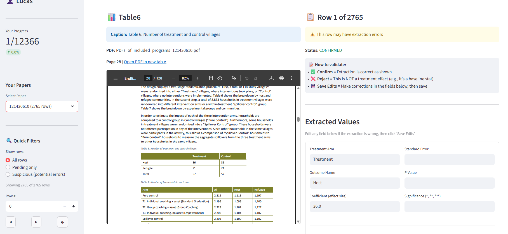

# DevChat v2 - Roadmap

**Last Updated:** January 31, 2026

> This document tracks **future features** and priorities.  
> For current implementation status, see [SETUP_TRACKER.md](../SETUP_TRACKER.md).  
> For extraction pipeline details, see [extraction_pipeline/README.md](../extraction_pipeline/README.md).

---

## Upcoming Features

### Immediate (Next Sprint)

1. **Full Extraction Dataset + Human Validation** - 6h (reduced from 8h)
   - ✅ **V3 COMPLETE:** Pilot on 54 studies → 48 (89%) extract data, 3,351 rows
   - ✅ **V4 COMPLETE:** SE-split parser, European format, treatments-in-cols → 51 (94%), 10,698 rows
   - ✅ **V5 COMPLETE:** Multi-language (ES/FR/PT) → 52 (96%), 10,551 rows
   - ✅ **V6 COMPLETE:** Figure caption extraction → 54 (100%), ~10,563 rows
   - ✅ **P1 COMPLETE:** Suspicious row filter removes metadata/noise
   - ✅ **P2 COMPLETE:** Transposed table detection (outcomes-in-rows)
   - ✅ **P3 COMPLETE:** 4 table orientations: columns, rows, treatments_in_cols, outcomes_in_rows_se_split
   - ✅ **P4 COMPLETE:** Prose + figure extraction fallbacks
   - ✅ **Step 1 COMPLETE:** Full corpus extraction → 92 studies (86 with data, 6 empty), 12,366 rows
   - **Step 2:** Human review of extracted data (spot-check ~10% of rows) ⬅️ **IN PROGRESS**
   - **Step 3:** Document FP/FN, calculate precision/recall
   - **Output:** `extraction_pipeline/outputs/full_corpus_for_validation.csv` (current: 12,366 rows)
   - Files: `extraction_pipeline/cli_v2.py`, `extraction_pipeline/combine_outputs.py`

2. **Ground Truth Validation** - 4h ⬅️ **NEXT PRIORITY**
   - Compare extracted values to master_UPG.csv ground truth
   - Calculate: outcome match rate, coefficient accuracy, SE accuracy
   - Identify systematic extraction errors for targeted fixes
   - Files: `validation_app/app_v2.py`, `data/master_UPG.csv`

3. **Domain-Specific Intervention Components** - 6h
   - Build LLM-based component extractor per `DOMAIN_CONFIGS` in `schemas.py`
   - Add CLI arg `--domain graduation|education|health`
   - Test on 3 domains
   - Files: `extraction_pipeline/pipeline.py`, `src/extraction/schemas.py`

4. **Study Design Filter in Evidence Panel** - 4h
   - Add dropdown to filter evidence by study design (RCT, DiD, etc.)
   - Files: `frontend/src/components/EvidencePanel.tsx`

5. **"I Don't Know" Explicit Refusal** - 2h
   - When retrieval confidence is below threshold, explicitly refuse to answer
   - Prevents hallucination when no good sources found
   - Files: `src/agents/devchat_agent.py`, `src/generation/claim_ledger.py`

### Short-Term

1. **Embedding Model Comparison: Cohere vs Voyage 4** - 6h
   - Benchmark Voyage AI 4 (launched Jan 15, 2026) against current Cohere embed-v4
   - Metrics: retrieval accuracy, speed, cost per 1M tokens
   - Files: `evaluation/benchmark_embeddings.py`

2. **Improve Faithfulness** - 8h
   - Current: 66.47%, Target: 70%+
   - Prompt tuning in Langfuse experiments
   - A/B test synthesis prompts

3. **Contextual Summarization (RCS)** - 8h
   - Before synthesis, LLM summarizes each chunk's relevance to query
   - Filters low-relevance chunks before passing to Claim Ledger
   - Files: `src/rag/retrieval.py`, `src/generation/claim_ledger.py`

4. **Smart Citations** - 12h
   - Classify citations as supporting/contrasting using OpenAlex data
   - Display: "38 Supporting | 3 Contrasting" badges
   - Files: New `src/enrichment/citation_classifier.py`

5. **Consensus Meter** - 16h
   - Visual: "Strong Support: 85%, 17/20 studies"
   - Extend ClaimLedger to track support/contradict per citation
   - Files: `src/generation/claim_ledger.py`, frontend component

6. **Self-Consistency** - 8h
   - Generate 3 answers with temperature > 0, select most consistent
   - Improves accuracy on complex synthesis questions
   - Files: `src/generation/claim_ledger.py`

### Medium-Term

1. **Agentic RAG** - 20h
   - Multi-step: Search → Review → Refine → Gather → Answer
   - Agent decides when to iterate on search

2. **Multimodal Support** - 24h
   - Extract tables/figures during PDF parsing
   - Vision LLM for captions, store in Qdrant

3. **Document Enrichment Pipeline** - 40h
   - Geography, intervention type, effect sizes extraction
   - Enables quantitative queries across studies

### Long-Term

1. **Systematic Review Workflow** - 40h
   - Protocol → Screening → Extraction → PRISMA flow

2. **Research Report Generation** - 30h
   - Auto-generate structured reports from evidence

3. **Embeddable Widget** - 16h
   - Embed DevChat on external sites (e.g., 3ie portal)

4. **Security Hardening** - 8h
   - Rate limiting, input validation, audit logs

5. **TruLens Evaluation** - 4h
   - Alternative RAG evaluation framework
   - Reference: https://www.trulens.org/

6. **Slack/Teams MCP Integration** - 20h
   - Let researchers query DevChat from Slack without switching apps
   - Example: `@devchat What effect sizes for cash transfers?`
   - Reference: [MCPs for Developers](https://www.oreilly.com/radar/mcps-for-developers-who-think-they-dont-need-mcps/)

7. **Context7-style Live Docs MCP** - 12h
   - Pull up-to-date methodology docs into agent context
   - Sources: 3ie methods guidance, PRISMA guidelines, Cochrane handbook
   - Reference: [Context7 MCP](https://block.github.io/goose/docs/mcp/context7-mcp)

---

## Success Metrics (Targets)

| Metric | Current | Target |
|--------|---------|--------|
| **Extraction: Study coverage** | 54/54 (100%) | 95%+ ✅ |
| **Extraction: Rows extracted** | 10,551 | - |
| **Extraction: Table orientations** | 4 types | - |
| **Extraction: Languages** | EN, ES, FR, PT | - |
| **Extraction: Fallbacks** | Prose + Figures | - |
| **RAG: Faithfulness** | 66.47% | 70%+ |
| **RAG: Citation Recall** | 98.86% | 70%+ ✅ |

---

## Completed This Session (Jan 31, 2026)

| Feature | Description |
|---------|-------------|
| **Modular Refactor** | Split pipeline.py into `core/`, `adapters/`, `postprocessing/` modules |
| **Error Handling** | `ErrorAccumulator` with stage context, `LLMFailureType` enum |
| **LLM Client** | Centralized `LLMClient` with caching, `sanitize_llm_response()` |
| **Schema Adapter** | `ColumnNames` constants, `normalize_authors()`, consistent field mapping |
| **Effect Size Assumptions** | Explicit `effect_size_assumption` column tracks calculation assumptions |
| **CLI v2** | New `cli_v2.py` with `--fast`, `--minimal`, `--no-prose`, `--no-figures` flags |

## Completed (Jan 29, 2026)

| Feature | Description |
|---------|-------------|
| **V4: SE-split parser** | Handles tables where SE is in separate rows below coefficients |
| **V4: European format** | Converts comma decimals (0,15) to dots (0.15) |
| **V4: Treatments-in-cols** | Extracts tables with treatment groups as column headers |
| **V5: Multi-language** | Spanish, French, Portuguese keywords for treatment detection |
| **V6: Figure extraction** | LLM extracts effects from figure captions when tables unavailable |
| **V6: Prose extraction** | LLM extracts effects from narrative text as fallback |
| **Regression check** | Verified V4 changes don't break previously working papers |

---

## References

- [PaperQA2](https://github.com/future-house/paper-qa) - Agentic RAG benchmark
- [Anthropic Contextual Retrieval](https://www.anthropic.com/news/contextual-retrieval) - 49% improvement technique
- [RAG-Fusion](https://arxiv.org/abs/2402.03367) - Multi-query retrieval
- [Lost in the Middle](https://arxiv.org/abs/2307.03172) - LLM context position bias
- [Binary Quantization](https://qdrant.tech/documentation/guides/quantization/) - Qdrant guide
- [Elicit](https://elicit.com/) - Systematic review automation
- [Scite](https://scite.ai/) - Smart Citations
- [TruLens](https://www.trulens.org/) - RAG evaluation framework

